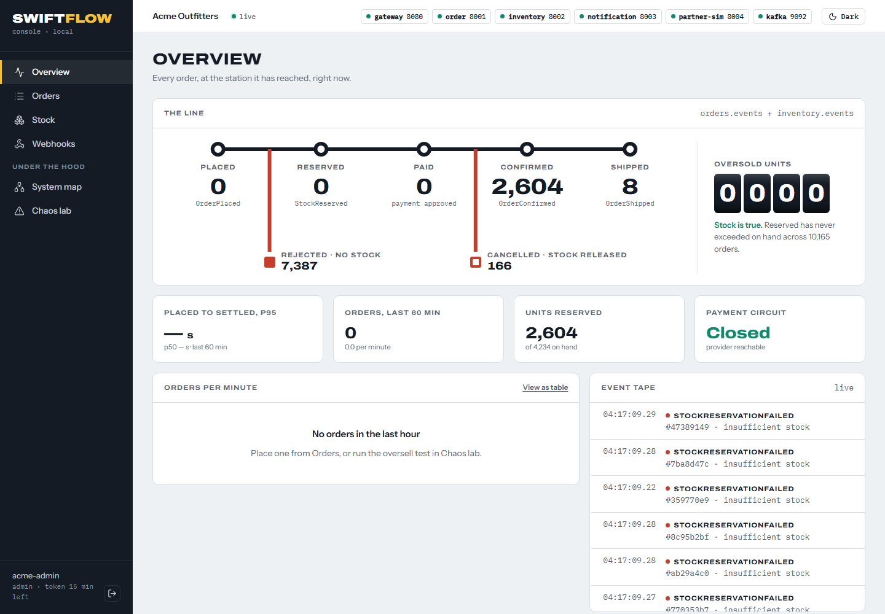
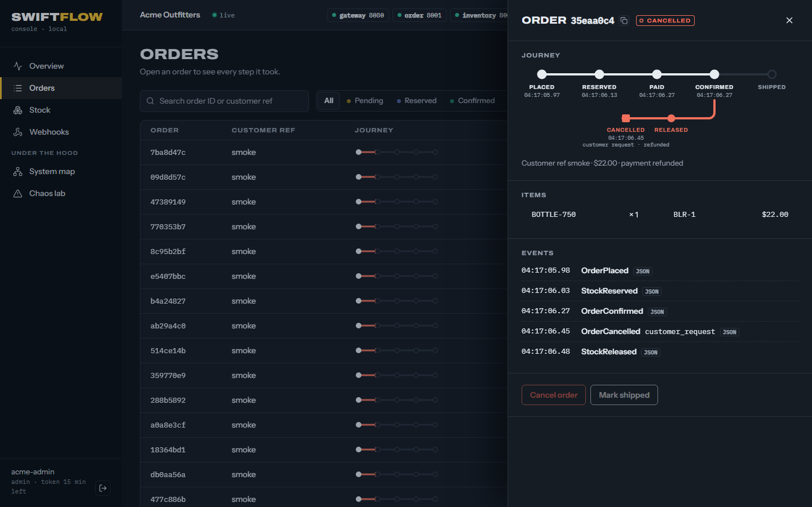
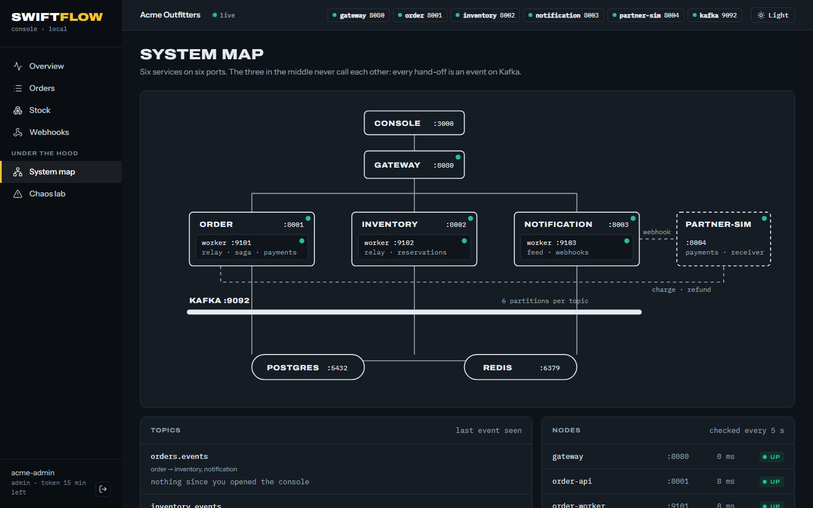
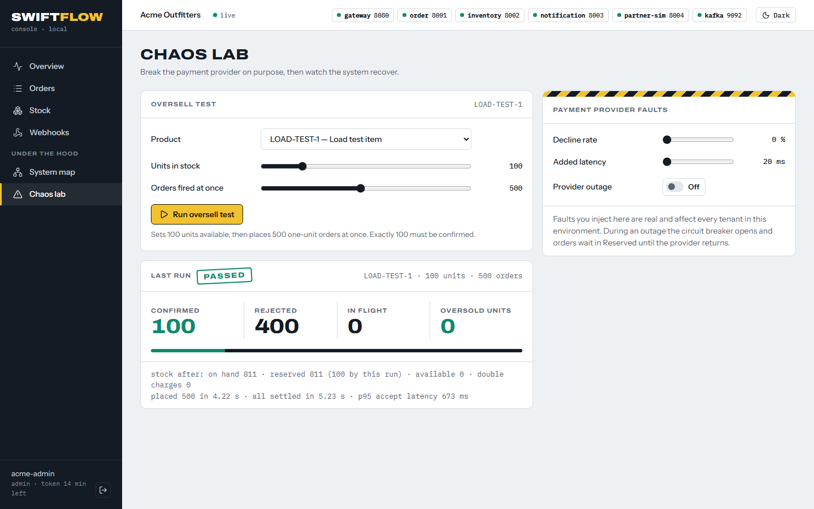
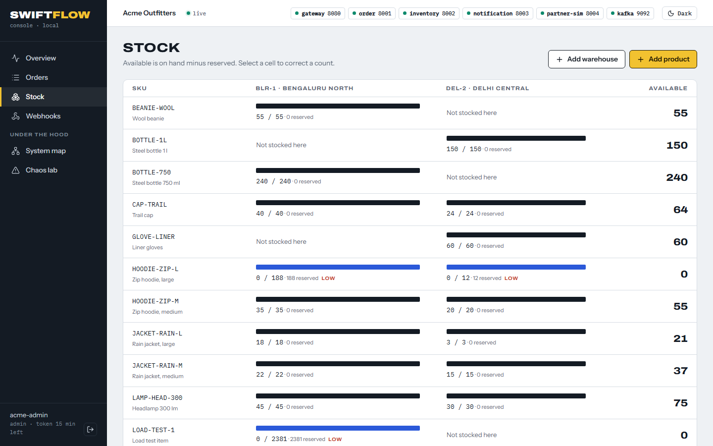
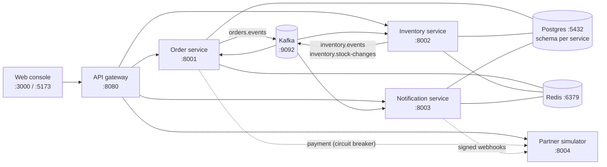

# SwiftFlow

**A multi-tenant order fulfillment and inventory platform that never oversells.**
Six independently deployable services, each on its own port, joined by Kafka events and a single API gateway, driven from one web console.

> Status: **built, running and tested.** Six services, the web console, and unit, integration, security, load and chaos tests. A GitHub Actions workflow ([ci.yml](.github/workflows/ci.yml)) runs lint, unit tests, the console build and the full stack with its integration, security and end-to-end suites; it has not yet run on GitHub. Kubernetes manifests are the remaining optional phase ([implementation plan](docs/implementation-plan.md)).



| | |
|---|---|
|  |  |
|  |  |

## Measured results

Run on a single laptop with everything in Docker (see [docs/results](docs/results/)).

| Test | Result |
|------|--------|
| **Oversell load test** — 500 concurrent one-unit orders against 100 units | **100 confirmed, 400 rejected, 0 oversold, 100 payments, 0 double charges**; all settled in about 11 s |
| **Chaos run** — workers killed 6 times and the Kafka broker restarted while 300 orders were in flight, 10 % of payments declined | Every order reached a final state; **all 12 invariants hold** (`chaos/check_invariants.py`) |
| **Security suite** — 81 attacks against the live stack (forged tokens, cross-tenant access, injection, SSRF, gateway abuse) | All refused |
| **Unit and contract tests** | 165 passing |
| **Integration tests** — real Postgres and Kafka (role isolation, row-level security, redelivery, poison messages) | 11 passing |
| **End-to-end smoke** — 21 checks through the gateway | 21 passing |

Throughput figures from this machine are not quoted: the load generator, not the platform, was the limit (a static file from nginx measured the same requests per second).

---

## What it proves

| # | Claim | How it is proven |
|---|-------|------------------|
| 1 | **No overselling** — 500 concurrent orders against 100 units reserve exactly 100 | `loadtest/oversell.py` + invariant checker; also a one-click run in the console's Chaos Lab |
| 2 | **No lost or duplicated events** — kill any process mid-order and every order still ends in a correct final state | Transactional outbox + idempotent inbox; `chaos/kill_mid_saga.ps1` |
| 3 | **Failure recovery** — a failed payment releases reserved stock automatically | Orchestrated saga with compensation |
| 4 | **Tenant isolation** — one tenant cannot read another's rows, even with a hand-written query | Postgres row-level security with `FORCE`, tenant taken only from the JWT |
| 5 | **Operability** — every order is traceable across services; health, lag and errors are visible | OpenTelemetry traces, Prometheus metrics, Grafana dashboards, live system map in the console |

## Architecture at a glance



The three domain services **never call each other**. Every hand-off is a Kafka event, and each service owns exactly one Postgres schema with its own database role. The only synchronous outbound calls are to the outside world (payment provider and partner webhooks), and both sit behind a hand-written circuit breaker.

## Services and ports

| Service | Port | Processes | Owns | Role |
|---------|------|-----------|------|------|
| `web` | 3000 (Docker) / 5173 (dev) | nginx / Vite | — | Operations console (React + TypeScript) |
| `gateway` | 8080 | api | — | Single entry point: routing, CORS, request IDs, trace propagation, aggregated health |
| `order` | 8001 | api, worker (metrics :9101) | `orders` schema | Auth (token issuer + JWKS), orders, saga orchestration, payments |
| `inventory` | 8002 | api, worker (metrics :9102) | `inventory` schema | Warehouses, products, stock, reservations |
| `notification` | 8003 | api, worker (metrics :9103) | `notifications` schema | Event feed, live stream (SSE), signed webhooks with retries |
| `partner-sim` | 8004 | api | in-memory | Stand-in payment provider + partner webhook receiver, with failure controls |

| Infrastructure | Port | Notes |
|----------------|------|-------|
| PostgreSQL 17 | 5432 | One instance, three schemas, three roles |
| Redis 7 | 6379 | Idempotency keys, rate limits, availability cache, live-event fan-out |
| Apache Kafka 4.1 (KRaft) | 9092 | No ZooKeeper; 6 partitions per topic |
| Prometheus / Grafana / Jaeger | 9090 / 3001 / 16686 | `observability` profile |

Full details: [docs/services.md](docs/services.md).

## Quick start

```powershell
# Everything in Docker, one command
.\swiftflow.ps1 up          # build + start the stack
.\swiftflow.ps1 seed        # demo tenants, warehouses, products, API clients
start http://localhost:3000 # sign in with a demo client shown on the login screen

# Or run each service on the host, on its own port, against Dockerised infra
.\swiftflow.ps1 infra       # Postgres, Redis, Kafka only
.\swiftflow.ps1 dev         # starts all six services in separate terminals

# Prove it
.\swiftflow.ps1 test        # lint + unit and contract tests (no stack needed)
.\swiftflow.ps1 test-int    # integration, security and end-to-end tests
.\swiftflow.ps1 load        # 500 orders against 100 units
.\swiftflow.ps1 chaos       # kill workers and the broker mid-run, then check invariants
```

## Deployment

**Live demo: https://swiftflow-amanmaskara04.eastasia.cloudapp.azure.com** (the VM is stopped when not in use to save credit, so it may be offline).

The demo runs on one Azure VM (Ubuntu 24.04, 2 vCPU, 4 GB, East Asia): the same Docker Compose stack plus Caddy for automatic HTTPS. Only ports 80 and 443 are open; SSH is closed and management goes through `az vm run-command`. Secrets are generated on the VM at first boot.

```powershell
.\deploy\azure\deploy.ps1 create    # resource group, VM, DNS name; first boot installs and starts everything
.\deploy\azure\deploy.ps1 update    # pull the latest commit on the VM and rebuild
.\deploy\azure\deploy.ps1 stop      # deallocate the VM so it stops using credit (start brings it back)
```

The hosted copy runs in demo mode: the demo clients are listed on the sign-in page so a visitor can try it, including the Chaos Lab.

## Documentation

| Document | What it covers |
|----------|----------------|
| [Architecture](docs/architecture.md) | Components, the order saga, outbox/inbox, failure handling, sequence diagrams |
| [Services](docs/services.md) | Every service: responsibilities, ports, processes, config, owned data, events in and out |
| [API reference](docs/api.md) | Every REST endpoint with request and response examples, errors, idempotency, rate limits |
| [Events](docs/events.md) | Kafka topics, the event envelope, every event type and its payload |
| [Database](docs/database.md) | Schemas, tables, roles, row-level security, the reservation query, migrations |
| [UI design](docs/ui-design.md) | Design system, tokens, every screen with wireframes, interaction and accessibility rules |
| [Local development](docs/local-development.md) | Running in Docker, running on the host, task runner, configuration |
| [Testing](docs/testing.md) | Test pyramid, integration scenarios, load, chaos, invariant checker |
| [Security](docs/security.md) | Threat model, the controls in place, what the security tests prove, known limits |
| [Environment](docs/environment.md) | What is installed on this machine and where (D: drive policy) |
| [Implementation plan](docs/implementation-plan.md) | Phased build order with exit checks |
| [Interview guide](docs/interview-guide.md) | Demo script, talking points, likely questions |
| [ADRs](docs/adr/) | The decisions and the reasons behind them |
| [Original build guide](SwiftFlow%20—%20Free-Tier%20Architecture%20&%20Build%20Guide.md) | The source brief these docs implement |

## Tech stack

**Backend:** Python 3.12, FastAPI, Pydantic v2, asyncpg, aiokafka, redis-py, httpx, tenacity, PyJWT (Ed25519), argon2-cffi, structlog, prometheus-client, OpenTelemetry, jsonschema
**Frontend:** React 18, TypeScript, Vite, TanStack Query, React Router, Tailwind CSS, Recharts
**Data and messaging:** PostgreSQL 17, Apache Kafka 4.1 (KRaft), Redis 7
**Platform:** Docker Compose (Kubernetes manifests and GitHub Actions are the planned next phase)
**Observability:** Prometheus, Grafana, Jaeger (OTLP)
**Testing:** pytest, pytest-asyncio, asyncio load generator, chaos script, invariant checker, headless-browser screenshots

## Cost

$0 out of pocket. Everything is open source and runs locally or on free GitHub-hosted runners; the hosted demo draws on Azure for Students credit (about $0.05 an hour while the VM is running). See section 13 of the original guide.
