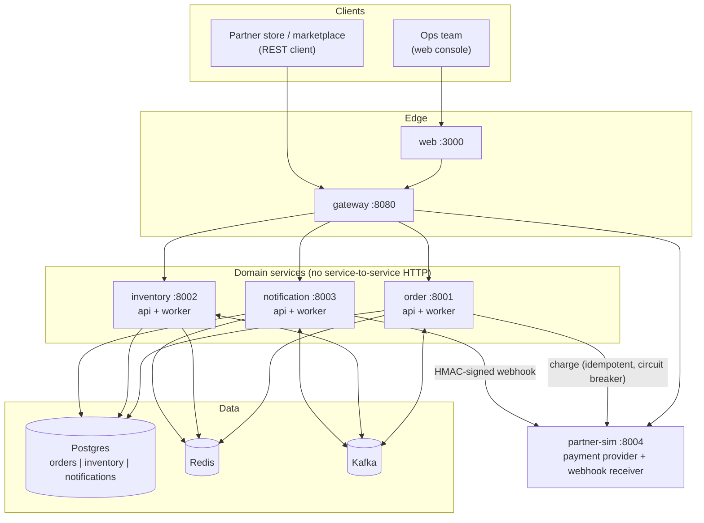
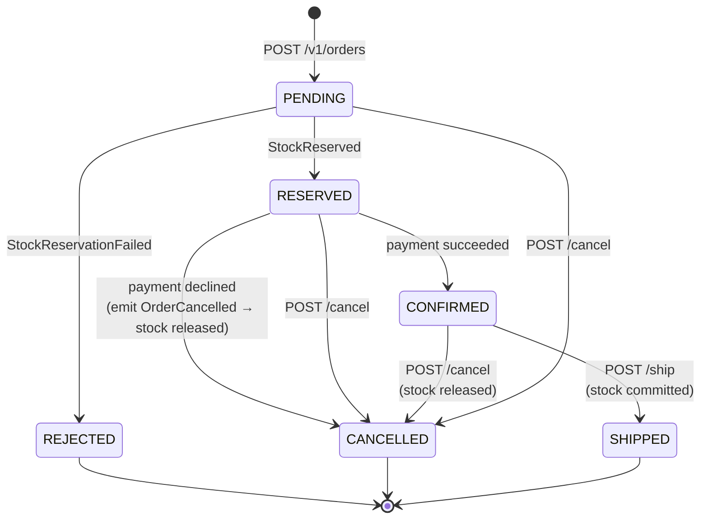
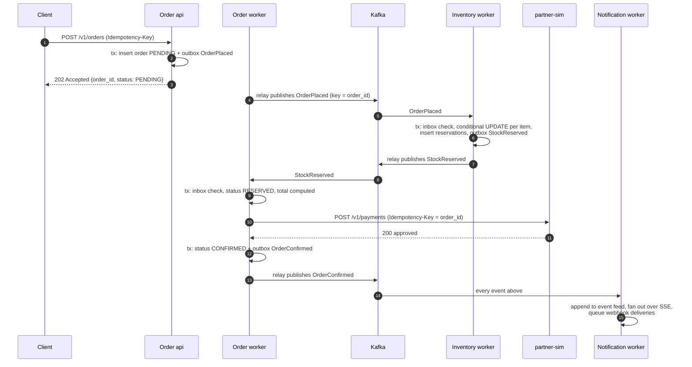
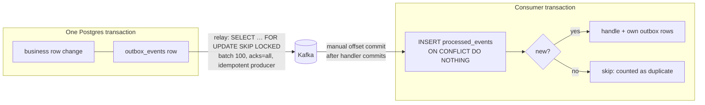
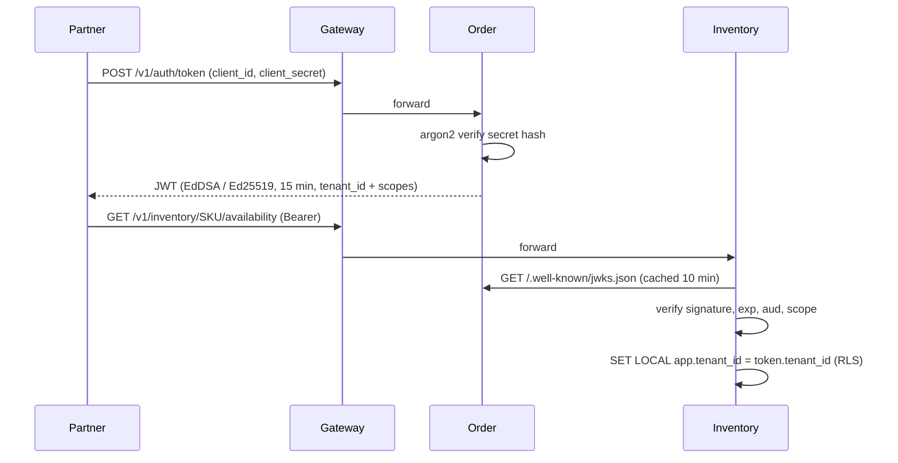

# Architecture

SwiftFlow is built from six services that each run as their own process on their own port. Three of them are **domain services** (Order, Inventory, Notification) that hold business data and talk to each other **only through Kafka**. The other three are **edge services**: a gateway that gives clients one address, a web console, and a partner simulator that plays the outside world.

## 1. System context



### Why each piece exists

| Component | Responsibility | Would break without it |
|-----------|----------------|------------------------|
| Gateway | One origin for the console and partners; routes by path; adds `X-Request-ID` and `traceparent`; aggregates health for the system map | Clients would need to know five ports; no single place for CORS and request IDs |
| Order | Issues tokens, accepts orders, **orchestrates the saga**, calls the payment provider | Nobody would own an order's lifecycle |
| Inventory | Holds stock per warehouse; reserves, releases and commits stock atomically | Overselling |
| Notification | Records every event as a tenant-visible feed, streams it live, delivers signed webhooks with retries | Partners would have to poll |
| Partner-sim | A controllable payment provider and webhook receiver, so failures can be demonstrated on demand | No way to show compensation or circuit breaking |

## 2. One image, two processes per domain service

Each domain service ships one Docker image that starts in one of two modes:

| Mode | Command | Job |
|------|---------|-----|
| `api` | `uvicorn app.main:app --port 800x` | Serves REST; writes business rows **and** outbox rows in one transaction |
| `worker` | `python -m app.worker` | Runs the outbox relay, the Kafka consumer and any background loops (payment processor, webhook dispatcher) as asyncio tasks; exposes `/metrics` on `910x` |

The API never talks to Kafka directly. This keeps request latency independent of the broker and lets workers scale on consumer lag while the API scales on request rate. In Kubernetes, each mode is its own Deployment.

## 3. The order saga

The Order service is the **orchestrator**: it holds each order's state and decides the next step or the compensation.



### Happy path



### Compensation paths

| Trigger | What Order does | What Inventory does | Final state |
|---------|-----------------|---------------------|-------------|
| Not enough stock for any item | Marks order `REJECTED` with the reason from `StockReservationFailed` | Nothing reserved (all-or-nothing transaction) | `REJECTED` |
| Payment declined | Marks `CANCELLED` (`payment_declined`), emits `OrderCancelled` | Releases every `ACTIVE` reservation, emits `StockReleased` | `CANCELLED` |
| Client cancels before shipping | Marks `CANCELLED`, emits `OrderCancelled`. If the order was already charged, sets `payment_status = REFUND_PENDING` and the payment processor refunds it (idempotency key `refund:<order_id>`) | Releases reservations (no-op if none yet) | `CANCELLED`, refunded if charged |
| Cancel races an in-flight charge | The charge result arrives for an order that is no longer `RESERVED`: if approved, it is recorded and immediately queued for refund | Already released | `CANCELLED`, refunded |
| Payment provider down | Circuit opens; order **stays `RESERVED`** and is retried by the payment processor with backoff | Reservation stays held | Completes when the provider recovers |
| Admin ships | Marks `SHIPPED`, emits `OrderShipped` | Commits: `on_hand -= qty`, `reserved -= qty`, reservation `COMMITTED` | `SHIPPED` |

### Why payment runs in a processor loop, not inside the consumer

The consumer handling `StockReserved` only records `RESERVED` and sets `next_payment_at = now()`. A separate **payment processor** loop in the Order worker:

1. Claims due orders with `SELECT … FOR UPDATE SKIP LOCKED`, sets a 30-second lease (`next_payment_at = now() + 30s`) and commits.
2. Calls the provider **outside** any database transaction, with `order_id` as the idempotency key.
3. Applies the result in a second transaction, only if the order is still `RESERVED` (a cancel may have won the race).

This means a slow provider never holds a row lock, a crash mid-call is recovered when the lease expires, and a retry can never charge twice.

## 4. Reliable messaging: outbox + inbox = effectively-once



- **No lost events.** The event row commits atomically with the state change. If the relay crashes after publishing but before marking rows published, they are published again — duplicates are allowed, losses are not.
- **No double effects.** Each consumer records `(consumer, event_id)` in `processed_events` **in the same transaction** as its effect. A redelivered event finds the row and does nothing.
- **Offsets are committed only after** the handler's transaction commits. A crash between the two causes a redelivery, which the inbox absorbs.
- **Poison messages** are retried three times with exponential backoff and jitter, then published to `<topic>.dlq` with `error`, `attempts` and `consumer` headers, so one bad message never blocks a partition.
- **Ordering.** Every event of one order uses `order_id` as its key, so it lands on one partition and is consumed in order.

This is **at-least-once delivery with idempotent consumers** — "effectively-once" — not exactly-once. Kafka transactions only give exactly-once inside Kafka, not across a database.

## 5. Preventing overselling

The reservation is one conditional `UPDATE` per item, evaluated under Postgres's row lock:

```sql
UPDATE inventory.stock_levels
SET    reserved = reserved + $qty, version = version + 1
WHERE  product_id = $product AND warehouse_id = $warehouse
  AND  on_hand - reserved >= $qty
RETURNING version;
```

Under `READ COMMITTED`, a second transaction waiting on the same row re-evaluates the `WHERE` clause against the committed row after the first one finishes, so two orders can never both take the last unit. A `CHECK (reserved <= on_hand)` constraint rejects the write even if application code is wrong. Multi-item orders lock rows in `(product_id, warehouse_id)` order to rule out deadlocks, and the whole order is one transaction: all items reserve or none do.

Redis is **not** part of correctness. It caches availability for reads only (5-second TTL, invalidated on change). See [ADR 0003](adr/0003-oversell-prevention.md) for why the guide's `version = :expected_version` clause is used for admin adjustments rather than on the hot reservation path.

## 6. Security model



- The **tenant always comes from the token**, never from the request body.
- Only the Order service holds the private key. Other services verify with the public key, so no signing secret is shared.
- Every tenant-scoped table has row-level security with `FORCE`, so even the table owner sees only the current tenant's rows.
- Webhooks are signed with HMAC-SHA256 over `timestamp.body`, and target URLs are checked against private, loopback and link-local ranges at subscription **and** delivery time (SSRF guard).
- Per-tenant token-bucket rate limiting in Redis returns `429` with `Retry-After`.

## 7. Observability

| Signal | Source | Where to look |
|--------|--------|---------------|
| Metrics | `prometheus-client` on every API (`/metrics`) and worker (`:910x/metrics`) | Prometheus :9090, Grafana :3001 |
| Traces | OpenTelemetry (FastAPI, httpx, asyncpg instrumentation) + `traceparent` stored in outbox headers and copied to Kafka headers | Jaeger :16686 — one order is one trace across all services |
| Logs | structlog JSON with `trace_id`, `tenant_id`, `order_id`, `request_id` | `docker compose logs`, or any log shipper |
| Live state | Gateway `/v1/system/health`, notification SSE stream | Console: System map and Overview |

## 8. Failure modes and what happens

| Failure | Effect | Recovery |
|---------|--------|----------|
| Order worker killed mid-saga | Uncommitted Kafka offsets; leased payments | Redelivery + inbox dedupe; lease expiry retries the payment idempotently |
| Inventory worker killed after reserving, before offset commit | `OrderPlaced` redelivered | Inbox row exists → skipped; `StockReserved` already in outbox |
| Relay killed after publish, before marking rows | Same events published twice | Consumers dedupe on `event_id` |
| Kafka broker down | APIs keep accepting orders (they only write Postgres); outbox grows | Relay drains the backlog when the broker returns; `OutboxStuck` alert fires meanwhile |
| Payment provider down | Circuit opens after 5 failures; orders wait in `RESERVED` | Half-open probe after 15 s; processor resumes |
| Redis down | Idempotency falls back to the DB unique constraint; rate limiting fails open; cache misses go to Postgres | Automatic when Redis returns |
| Malformed event | Retried 3 times, then sent to `.dlq` | Inspect, fix, replay |

## 9. Scaling limits (honest version)

- One Kafka broker means replication factor 1. Production would use 3 brokers with `min.insync.replicas=2`.
- Consumers scale up to the partition count (6 per topic).
- One Postgres instance is the main bottleneck; the next step is a read replica for availability queries and partitioning `outbox_events` by time.
- A single relay per service preserves per-key publish order. Running several relays with `SKIP LOCKED` would need ordering by key, or a CDC relay such as Debezium.
